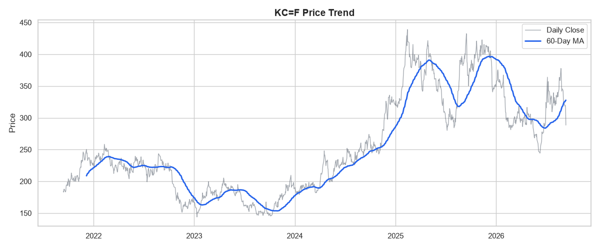
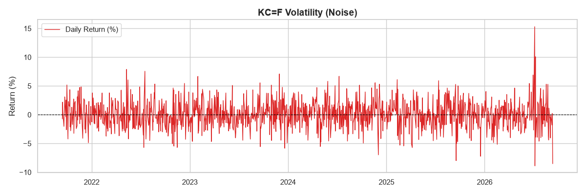
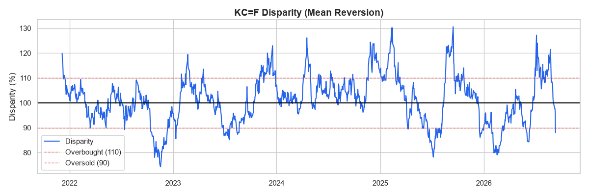
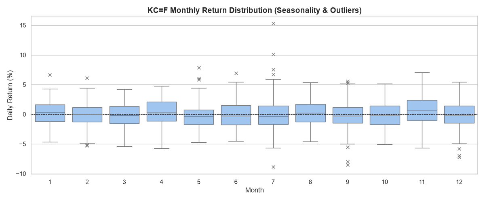

# 📊 시계열 데이터 분석 리포트: 커피 원두(KC=F) 가격 트렌드 및 변동성

## 1. 분석 주제 및 데이터 설명
* **분석 주제:** 국제 커피 원두 선물 가격의 장기 흐름, 일간 변동, 이동평균 대비 이격과 월별 수익률 분포를 관찰한다. 기후·수급과의 관계는 이 가격 데이터만으로 검증하지 않은 가설이다.
* **데이터 출처:** [Yahoo Finance `KC=F`](https://finance.yahoo.com/quote/KC%3DF/history/)를 `yfinance`로 조회했다. [ICE Coffee C 계약 명세](https://www.ice.com/products/15/coffee-C-Futures)는 원 계약의 가격 호가를 파운드당 미국 센트로 정의한다.
* **데이터 기간 및 크기:** 2021-09-13 ~ 2026-09-11 (작성 당시 5년), 총 1,258개 **거래일** 데이터 포인트. 2026-10-27에 같은 날짜 범위를 재조회해 건수와 아래 주요 극단값을 확인했다.
* **데이터 정제 기준:** 이 날짜 범위의 재조회 원자료에는 NaN이 **0개**였다. 주말·휴장일은 빈 행이 아니라 데이터에 없는 날이므로 채우지 않았다. `analysis.py`에는 원자료 행에 NaN이 있을 때만 `ffill()`하는 조건부 코드가 있지만, 이번 표본에는 적용되지 않았다. 이동평균의 첫 59행과 수익률의 첫 행에서 생기는 NaN은 계산상 값이며 분석용 유효 행을 선택할 때 제외한다.
* **재현성:** 현재 `analysis.py`의 `PERIOD='5y'`는 실행 날짜에 따라 기간이 달라진다. 저장소에 원자료 CSV와 고정 의존성 버전이 없고 데이터 제공자가 과거 값을 수정할 수 있으므로, 이 문서의 숫자는 위 고정 기간의 기록이다. 정확한 재현에는 원자료·수집 시각·라이브러리 버전 보관이 필요하다.

## 2. 분석 질문 4가지
1. **[트렌드]** 매일의 가격 등락을 60거래일 이동평균선으로 다듬어냈을 때, 커피 가격의 큰 흐름은 어떻게 달라 보이는가?
2. **[노이즈]** 최근 5년간 하루 단위로 가격 변동폭이 가장 극단적으로 튀었던(Spike) 시점은 언제이며, 그 변동률은 얼마인가?
3. **[이격도]** 가격이 60거래일 이동평균보다 10% 이상 높아진 뒤 이격도는 어떻게 변하며, 100 이하로 복귀하기까지 얼마나 걸리는가?
4. **[계절성]** 월별로 노이즈(이상치)가 집중되는 계절적 패턴이 존재하는가?

## 3. 시각화 결과물 및 구간별 통계

### [시각화 1] 종가 트렌드와 60일 이동평균선

### [시각화 2] 일일 주가 수익률 (노이즈 분석)

### [시각화 3] 이격도 분석 (복귀 패턴 탐색)

### [시각화 4] 월별 수익률 분포 및 이상치 탐색 (박스 플롯)

### [구간별 통계] 연도별 변동성 요약표
| Year | 평균 수익률(%) | 표준편차(리스크) | 최대 하락(%) | 최대 상승(%) |
| :--- | :--- | :--- | :--- | :--- |
| 2021 | -0.38 | 1.93 | -4.87 | 2.52 |
| 2022 | -0.09 | 2.30 | -5.70 | 7.89 |
| 2023 | 0.07 | 2.25 | -5.83 | 7.08 |
| 2024 | 0.24 | 2.25 | -6.98 | 6.69 |
| 2025 | 0.06 | 2.39 | -7.98 | 6.11 |
| 2026 | -0.07 | 2.83 | -8.89 | 15.30 |

위 표는 리포트 작성 당시 출력값이다. 2026-10-27에 같은 날짜 범위를 현재 설치된 `yfinance`로 다시 조회했을 때 2026년 평균·표준편차는 각각 **-0.02%·2.76%**로 달랐고, 최대 상승·하락 날짜와 값은 재현됐다. 과거 시세 수정·조정 방식·라이브러리 버전 중 어느 차이가 원인인지는 분리 검증하지 않았다. 원자료와 버전을 고정하기 전에는 위 표를 현재 재현값이라고 주장하지 않는다.

## 4. 데이터 인사이트 (관찰과 해석 분리)

**💡 분석 질문 1에 대한 해답 (트렌드와 주기성)**
* **관찰(Fact):** [시각화 1]에서 일별 가격(회색)보다 60**거래일** 이동평균(파란색)이 완만하다. 표본 안에 큰 상승·하락 구간이 보이지만 정확히 반복되는 주기는 계산하지 않았다.
* **가능한 이유(Why):** 기후·생산량·재고·수요 및 선물 계약 교체가 가격 변화와 관련될 수 있다. 이 그래프만으로 어느 요인이 원인인지, 1.5~2년 주기가 안정적으로 존재하는지는 알 수 없다.
* **다음 행동(Action):** 60거래일 창을 다른 길이와 비교하고, 더 긴 기간의 가격·기후·생산량 자료와 자기상관/주기 분석으로 반복성을 확인한다.

**💡 분석 질문 2에 대한 해답 (극단적 노이즈의 발생 원리)**
* **관찰(Fact):** 이 고정 기간의 최대 일간 상승률은 **2026-07-06 +15.30%**, 최대 하락률은 다음 거래일 **2026-07-07 -8.89%**다. 이는 두 날짜의 계산값이며 전형적인 하루 변동률의 범위를 따로 추정한 결과는 아니다.
* **가능한 이유(Why):** 기상·수급 뉴스, 선물 월물 교체, 자료 오류 등 여러 설명이 가능하다. 가격 두 점만으로 기상 이변이나 투자자의 차익 실현을 원인으로 확정할 수 없다.
* **다음 행동(Action):** 날짜별 원가격과 계약 월물·외부 뉴스·기상 기록을 대조하고, 두 극단값을 포함/제외한 변동성 통계를 비교한다.

**💡 분석 질문 3에 대한 해답 (이격도와 복귀 시간)**
* **관찰(Fact):** [시각화 3]의 최대 이격도는 **2025-09-15의 130.55**다. 이는 가격이 60거래일 평균보다 약 30.55% 높았다는 뜻이다. 110 상향 돌파 후 100 이하까지의 시간은 사례마다 달랐고, 재계산한 한 사례(2024-11-15 돌파)는 **95거래일**이 걸렸다.
* **가능한 이유(Why):** 일시적인 가격 충격 뒤 이격이 줄어드는 경우가 있지만, 이 자료만으로 항상 빠른 평균 회귀가 일어나거나 이동평균이 본래 가치라는 결론을 낼 수 없다.
* **다음 행동(Action):** 모든 110 상향 돌파를 독립 사건으로 정의해 복귀 비율·소요 기간·미복귀 사례를 집계하고, 다른 기간의 자료로 검증한다. 이격도만으로 매매 신호를 만들지 않는다.

**💡 분석 질문 4에 대한 해답 (계절성과 박스 플롯)**
* **관찰(Fact):** [시각화 4]는 여러 해의 **일별 수익률을 월별로 묶은 분포**다. 재조회 표본에서 각 월의 1.5×IQR 기준 이상치는 7월 **5/107건**, 9월 **5/103건**이었다. 7월에만 극단값이 나타난 것은 아니다.
* **가능한 이유(Why):** 월별 기후·수확 일정이 영향을 줄 가능성은 있지만, 약 5년의 가격 자료와 박스 플롯만으로 계절성이나 브라질 서리의 인과 효과를 입증할 수 없다. 연도별 시장 상황과 계약 교체 효과도 섞여 있다.
* **다음 행동(Action):** 월별 표본 수와 연도 효과를 조정해 더 긴 기간에 반복되는지 검정하고, 산지 기상·생산량·계약 정보를 결합한다.

## 5. 결론 및 한계점
* **결론:** 60거래일 이동평균·일간 수익률·이격도·월별 분포를 함께 보면 장기 흐름과 단기 극단값을 서로 다른 관점에서 설명할 수 있다. 이들은 **기술적 관찰 지표**이며, 원인이나 미래 가격·투자 성과를 증명하지 않는다.
* **한계점:** 가격이라는 단일 변수, 약 5년의 표본, 동적 `5y` 조회와 원자료 미보관 때문에 인과·계절성·재현성에 한계가 있다. 가격 외에 기상·생산량·재고·계약 월물·뉴스를 결합하고 별도 기간에서 검증해야 한다.

## 6. AI 사용 로그
* **사용 작업:** 프로젝트 초기 환경 구축 가이드, `yfinance` 튜플 반환 오류 해결(호환성 패치), 월별 변동성 통계(박스 플롯) 로직 구현 및 전체 코드 리팩토링.
* **사용 이유:** 하드코딩을 방지하고 명시적 예외 처리가 포함된 실무 수준의 깔끔한 코드를 빠르게 구축하기 위함. 또한, 관찰(Fact)과 해석(Hypothesis)을 철저히 분리하는 데이터 리터러시적 글쓰기 구조를 정교하게 다듬기 위해 활용.
* **검증 방법:** 코드를 로컬에서 실행하고 고정 기간을 다시 조회해 1,258건과 최대 상승·하락·이격도 값을 재계산했다. Git 이력에서 박스 플롯과 통계표 추가를 확인했다. AI의 원인 설명·계절성·예측 주장은 데이터만으로 검증되지 않으므로 사실로 채택하지 않았다. 프롬프트·응답 원본은 저장소에 없어 AI의 정확한 기여 범위를 독립적으로 증명할 수는 없다.
